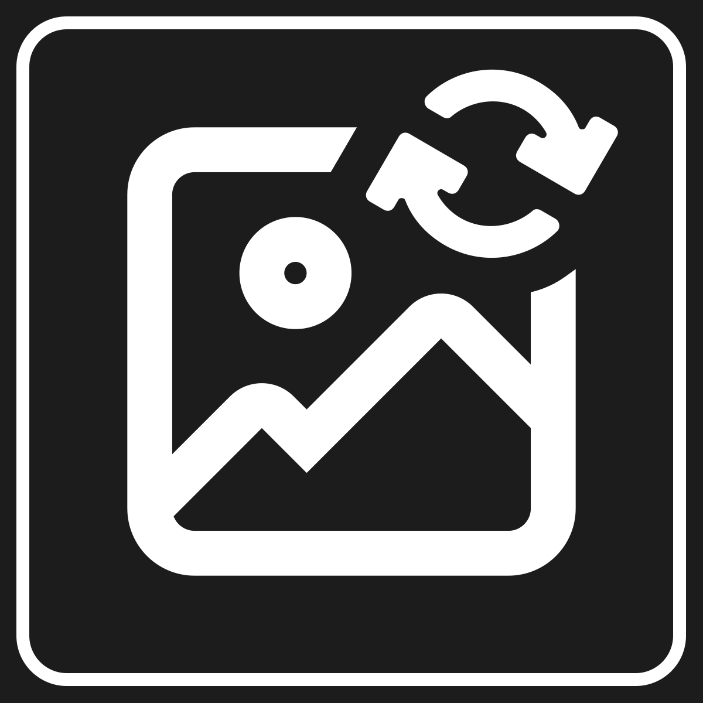
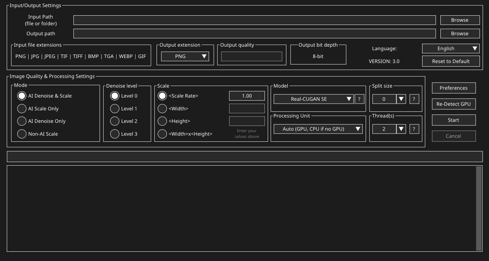
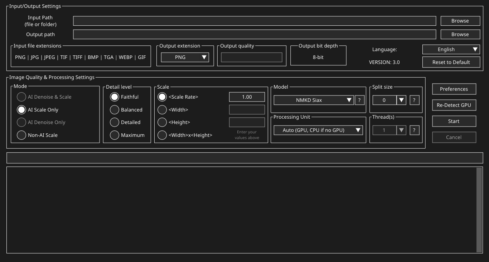
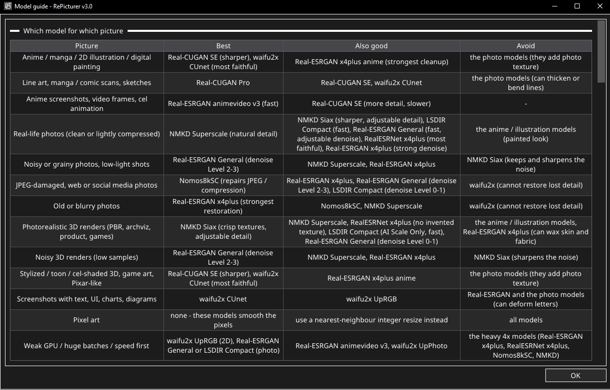
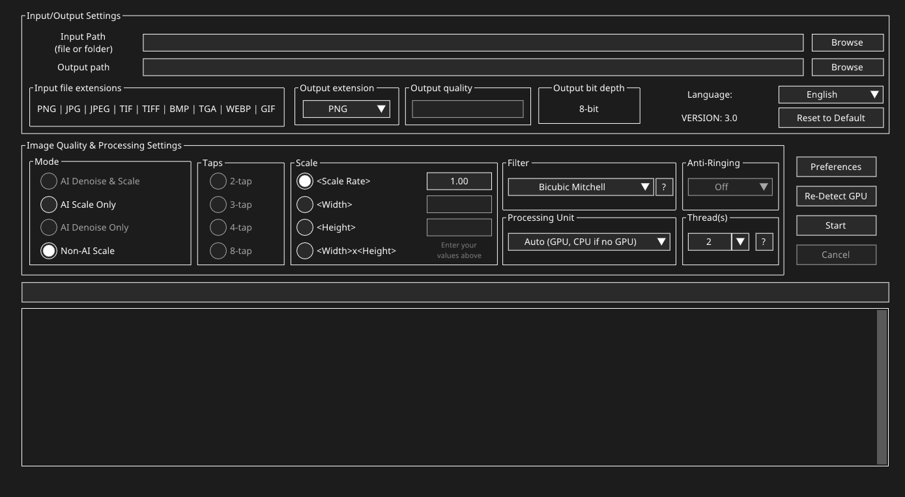
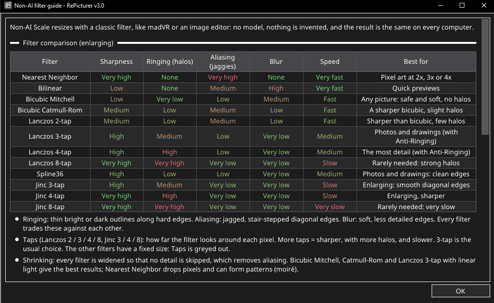
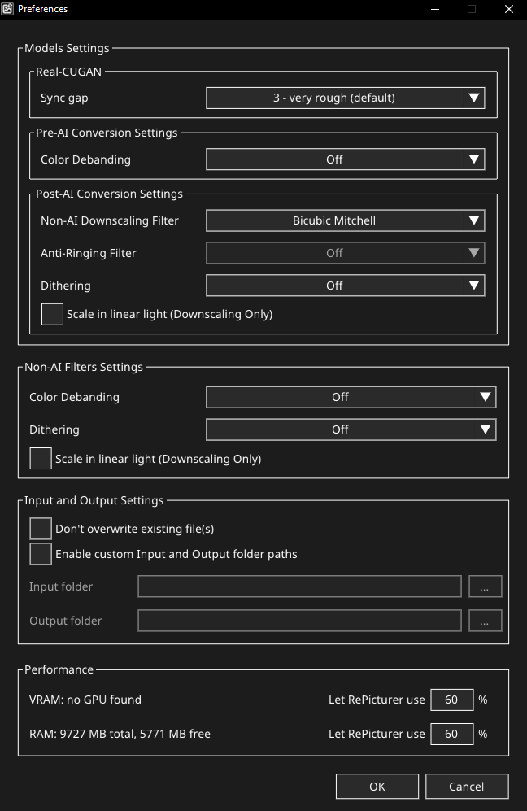

# RePicturer

<p align="center"></p>

**RePicturer** is the world-best and most advanced free, open-source AI and Non-AI upscaler and denoiser for **Windows and Linux**.

* **AI features:** An AI denoiser and an AI upscaler with **16 AI models**, for every kind of picture: 2D anime and
  illustrations, real-life photos and even 3D renders.
* **Non-AI features:** An image scaler with popular high-quality resampling filters (Lanczos, Bicubic, Spline36, Jinc ...).

RePicturer is fully portable, runs on any **Vulkan** GPU (NVIDIA, AMD, Intel, etc.) and has a built-in CPU fallback.
There is no installation, and no CUDA, Python or other environment to set up: just unzip, click and run.

The GUI of RePicturer is inspired by **waifu2x-caffe** (lltcggie). RePicturer may look a little similar, but it has a lot of
changes and improvements. The converter (`repicturer-cli`) is built on and inspired by **waifu2x-ncnn-vulkan**,
**realcugan-ncnn-vulkan** (nihui) and **Real-ESRGAN-ncnn-vulkan** (Xintao Wang), all running on Tencent's **ncnn**.
RePicturer is an independent project; it is not affiliated with these projects or the model authors.



## Download

Get `RePicturer-windows.zip` or `RePicturer-linux.zip` from the **[Releases](https://github.com/Valdraath/repicturer/releases)** page, unzip it anywhere and start
`RePicturer.exe` (Windows) or `./RePicturer` (Linux). The release downloads contain the program, the converter and all models.

## OS requirement

* **Windows:** Fully tested on Windows 10 and Windows 11 (64-bit).
* **Linux:** Fully tested on the 2 latest versions of Ubuntu, Debian and Fedora, and on the latest Arch Linux (see [Linux: first start](#linux-first-start) for the Vulkan driver).
* **macOS:** Not supported.

## Hardware requirement

* **GPU (default):** Any Vulkan GPU, with no CUDA needed:
  * NVIDIA GTX 600 series and newer (GTX 1050 … RTX 50)
  * AMD GCN and newer (RX 470/570 … RX 9000)
  * Intel HD 500+, Iris Xe and Arc

  At startup RePicturer checks which fp16/int8 features each device supports. The split (tile) size is chosen automatically from free video memory, so 2 GB cards work.
* **CPU:** Used **only as a fallback** when no Vulkan GPU exists (or when you select it). All three engines work on any x86-64 Intel or AMD CPU, with SSE2/AVX/AVX2/AVX-512 chosen at runtime. It is 10-100x slower than a GPU.
* **Driver:** If *Re-Detect GPU* finds nothing, update the graphics driver. On Linux, install the Mesa Vulkan drivers (`mesa-vulkan-drivers`) or the NVIDIA driver, plus `libvulkan1`.

## Linux: first start

1. **Unpack** the zip (use `unzip`, it keeps the executable permission):

   ```
   unzip RePicturer-linux.zip
   cd RePicturer-linux
   ```

2. **Make the programs executable.** Three files need the `+x` permission: `RePicturer` (the app), `repicturer-cli`
   (the converter it runs) and `install-desktop-entry.sh`. Some archive tools and downloads drop it, so run this once:

   ```
   chmod +x RePicturer repicturer-cli install-desktop-entry.sh
   ```

3. **Start it:**

   ```
   ./RePicturer
   ```

4. **Optional: add it to the application menu** (with its name and icon, no root needed). Run it again if you move the folder:

   ```
   ./install-desktop-entry.sh
   ```

**Requirements:** a 64-bit Linux with glibc 2.27 or newer (Ubuntu 18.04+, Debian 10+, Fedora, Arch, ...), an X11 or
Wayland desktop (Wayland through XWayland), OpenGL 3.0 and a **Vulkan driver**:

| Distribution | Install the Vulkan driver |
|---|---|
| Ubuntu / Debian / Mint | `sudo apt install libvulkan1 mesa-vulkan-drivers` (NVIDIA: the proprietary driver) |
| Fedora | `sudo dnf install vulkan-loader mesa-vulkan-drivers` (NVIDIA: the proprietary driver) |
| Arch / Manjaro | `sudo pacman -S vulkan-icd-loader` plus `vulkan-radeon`, `vulkan-intel` or `nvidia-utils` |

**If something goes wrong:**

* **"Permission denied"** when starting it: Step 2 was skipped, run the `chmod` command.
* **Nothing happens on double-click** in the file manager: Start it from a terminal with `./RePicturer`, or use the menu
  entry from step 4.
* **Re-Detect GPU finds no GPU:** Install or update the Vulkan driver above. Without one, RePicturer still works on the CPU,
  only much slower.

## Support the project

If you like the project, consider supporting me at: **[paypal.me/TheRunningRiot](https://paypal.me/TheRunningRiot)**

## Features

### Four modes

* **AI Denoise & Scale:** Removes noise, JPEG artifacts and blur, then enlarges the picture.
* **AI Scale Only:** Enlarges the picture with an AI model, without denoising.
* **AI Denoise Only:** Cleans the picture and keeps its size.
* **Non-AI Scale:** Resizes with a classic resampling filter. No model, nothing is invented, and the result is the same on
  every computer.

### AI upscaling and denoising

* **16 AI models on 3 engines** (waifu2x, Real-CUGAN and Real-ESRGAN), for anime and illustrations, line art and comics,
  anime video frames, real-life photos, JPEG-damaged pictures, and photorealistic, stylized or noisy 3D renders. See
  [Models and filters](#models-and-filters).
* **Denoise levels 0-3**, with a hover tip that explains what each level does for the chosen model.
* **Detail level** for NMKD Siax: Faithful / Balanced / Detailed / Maximum, from soft and faithful to the sharpest detail.
* **Controls that follow the model:** Options a model cannot use are greyed out, with a tooltip that says why. Models
  with built-in cleanup switch to AI Scale Only by themselves, and heavy 4x models lock Thread(s) to 1, so they never run
  out of GPU memory.



* **Model guide:** The **?** button next to the model list shows which model is best, also good or to avoid for each kind
  of picture, and explains every model.



### Any size

* **Scale rate** (e.g. 2.25x, also 1.00x), **target width**, **target height** or an exact **width x height**
  (e.g. 1920x1080).
* Every size is really processed: the AI runs and the result is shrunk to the exact size you asked for. See
  [How any scale works](#how-any-scale-works).

### Non-AI Scale

* **12 resampling filters:** Nearest Neighbor (pixel art), Bilinear, Bicubic Mitchell, Bicubic Catmull-Rom, Lanczos
  2 / 3 / 4 / 8-tap, Spline36 and Jinc 3 / 4 / 8-tap. In this mode the main window shows **Filter**, **Taps** and
  **Anti-Ringing** in place of the model options.
* **Anti-Ringing:** Off / Relaxed / Strict (Soft) removes the halos (thin light or dark outlines) that sharp filters leave
  along hard edges. Filters without halos show it as Off, greyed out; your choice comes back with a sharper filter.
* **Scale in linear light** when a picture gets smaller, so thin bright lines and dots do not turn darker.
* **Color Debanding** and **Dithering** (see below).
* Runs on the GPU or the CPU, with the same result.



* **Filter guide:** The **?** button next to the filter list compares every filter (sharpness, halos, jaggies, blur,
  speed) and says what each one is best for.



### Picture quality tools

* **Color Debanding** (Off / Low / Medium / High): smooths away colour banding, the visible steps in skies, shadows and
  soft gradients that are common in game art, old 3D renders and heavily compressed JPGs. Only flat areas change; edges,
  lines and texture stay as they are. It runs before AI Conversion, so the AI does not sharpen the bands.
* **Dithering** (Off / Ordered / Error Diffusion): hides the steps a very smooth fade can get when a picture is resized,
  with a very fine grain.
* **Post-AI Conversion:** When the AI result has to be shrunk to your exact size, you choose the resampling filter (Bicubic
  Mitchell by default, or Catmull-Rom, Lanczos 3 / 4-tap, Spline36, Jinc 3-tap), its anti-ringing, dithering and linear light.

### Preferences

<p align="center"></p>

* **Models Settings:**
  * **Real-CUGAN Sync gap:** Keeps the colours of a big picture even across all the pieces it is converted in.
  * **Pre-AI Conversion Settings:** Color Debanding before AI Conversion.
  * **Post-AI Conversion Settings:** The Non-AI Downscaling Filter, Anti-Ringing Filter, Dithering and Scale in linear light.
* **Non-AI Filters Settings:** Color Debanding, Dithering and Scale in linear light for the Non-AI Scale mode.
* **Input and Output Settings:** Don't overwrite existing files, and optional custom input and output folders.
* **Performance:** How much of the free GPU memory (VRAM) and RAM RePicturer may use (20-80 %, default 60 %).

### Pictures, folders and formats

* **One picture or a whole folder**, sub folders included, with drag & drop.
* **Input:** PNG, JPG, JPEG, TIF, TIFF, BMP, TGA, WEBP and GIF. 16-bit files are read and converted.
* **Output:** PNG, BMP, JPG, JPEG 2000, Sun Raster, TIFF, HDR, EXR, PPM, WebP, TGA and GIF, with a quality setting
  (WebP quality 101 = lossless). The output is always 8 bit, because the AI models work in 8 bit.
* **Animated GIF and WebP stay animated**, with frame timing and loop count kept. GIF can become animated WebP and vice
  versa. GIF output uses an optimized 256-colour palette per frame, with transparency.
* **Transparency** is kept and converted with the picture.
* **Automatic output names**, e.g. `name(RealCUGAN-SE)(noise_scale)(Level0)(x2.00).png` or
  `name(Lanczos3)(AR-Relaxed)(x2.00).png`.
* **Built-in file explorer:** A fast, dark file browser in its own window (address bar, back / forward / up, home folders
  and drives, search as you type, keyboard navigation). It remembers the last folder, only lists the picture types
  RePicturer reads, and checks the input and output paths before you start.

### Speed, memory and reliability

* **Processing Unit:** Auto, any GPU, or the CPU, with a **Re-Detect GPU** button.
* **Split size:** 0 = automatic from the free GPU memory, 1 = the whole picture in one piece, or a size of your choice.
* **Thread(s):** How many pictures are converted at the same time (GPU), or how many processor cores are used (CPU).
* **Memory limits:** RePicturer never uses more than the share of free VRAM and RAM you allow. A Split size that cannot fit
  is lowered before the run, and pictures wait for free RAM instead of overloading the computer.
* **Automatic recovery:** A picture that fails on the GPU is retried up to 2 times (first in 2 pieces, then as 1). A broken
  or half-empty picture is never saved; if a picture still fails, the conversion stops with a clear message.
* **Pass report:** The log shows exactly what ran for every picture, e.g.
  `noise2_scale2.0x_model (x2) -> scale2.0x_model (x2) -> resize 800x600 to 2560x1920`.
* Progress bar, time left and a log.

### Easy to use

* **Hover tips** on every option, in plain words, and **?** buttons that open short guides.
* **Safe input:** Every field only accepts valid values (scale, size, the quality range of each format, memory shares),
  with a warning right away instead of a failed conversion.
* **Dark theme**, sharp text in every language, and a window that can be resized and maximized: everything scales with it.
* **10 languages:** English, Chinese (Simplified / Traditional), Japanese, Korean, Portuguese (Brazil), Russian, Spanish,
  Ukrainian and Vietnamese, with bundled Noto fonts.
* **Settings are remembered** in `setting.ini` next to the program, checked and repaired at startup. Reset to Default
  restores every setting except your language.
* **Portable:** Unzip and run, nothing is installed. On Linux a menu entry is one script away.
* **Command line:** Every feature is also available from a terminal with `repicturer-cli`.

### What's in the download

```
RePicturer(.exe)              the program
repicturer-cli(.exe)          the converter (also usable from the command line)
models-*/                     16 AI models
lang/                         10 languages
fonts/                        Noto Sans fonts for every language
crop_size_list.txt            split size presets
CLI Guide/                    the full command line guide, in 10 languages
icon.png, install-desktop-entry.sh   (Linux) application menu entry
```

## Command line

`repicturer-cli` is the converter behind the window. You can run it yourself in a terminal (Command Prompt, PowerShell or a
Linux shell), a script or a batch file. Every setting of the window, Preferences included, has an option:

```
repicturer-cli -i in -o out [-M denoise-scale|scale|denoise|non-ai-scale] [-s rate | -W width | -H height]
               AI modes:     [-m model-folder] [-n level] [-t split-size] [-c sync-gap]
               filters:      [-F filter] [-T taps] [-a off|relaxed|strict] [--linear-light]
                             [--dither off|ordered|error-diffusion] [--deband off|low|medium|high]
               output:       [-f format] [-q quality] [-r] [-k] [-l png:jpg] [-L list.txt]
               performance:  [-g gpu(s)] [-j load:process:save] [--vram-percent 20-80] [--ram-percent 20-80]
               [--list-gpu] [--progress] [-v]
```

Examples (on Linux, start the name with `./`; in PowerShell, with `.\`):

```
# anime picture, 2x, Real-CUGAN SE with a light denoise
repicturer-cli -i art.png -o art-2x.png -m models-realcugan-se -n 1 -s 2

# photo to exactly 3840 pixels wide, NMKD Superscale
repicturer-cli -i photo.jpg -o photo-4k.png -M scale -m models-nmkd-superscale -W 3840

# pixel art, 4x, no AI
repicturer-cli -i sprite.png -o sprite-4x.png -M non-ai-scale -F nearest -s 4

# a whole folder with sub folders, to WebP, skipping pictures already done
repicturer-cli -i Pictures -o Pictures-2x -r -k -f webp -q 90 -m models-realcugan-se -s 2
```

For the full guide, with every option explained and many more examples, read the **`CLI Guide`** folder in the
RePicturer folder. It is also online:

* **Windows:** [English](docs/CLI%20Guide/English-Windows.md) · [Tiếng Việt](docs/CLI%20Guide/Vietnamese-Windows.md) · [简体中文](docs/CLI%20Guide/Chinese-Simplified-Windows.md) · [繁體中文](docs/CLI%20Guide/Chinese-Traditional-Windows.md) · [日本語](docs/CLI%20Guide/Japanese-Windows.md) · [한국어](docs/CLI%20Guide/Korean-Windows.md) · [Português](docs/CLI%20Guide/Portuguese-Brazil-Windows.md) · [Русский](docs/CLI%20Guide/Russian-Windows.md) · [Español](docs/CLI%20Guide/Spanish-Windows.md) · [Українська](docs/CLI%20Guide/Ukrainian-Windows.md)
* **Linux:** [English](docs/CLI%20Guide/English-Linux.md) · [Tiếng Việt](docs/CLI%20Guide/Vietnamese-Linux.md) · [简体中文](docs/CLI%20Guide/Chinese-Simplified-Linux.md) · [繁體中文](docs/CLI%20Guide/Chinese-Traditional-Linux.md) · [日本語](docs/CLI%20Guide/Japanese-Linux.md) · [한국어](docs/CLI%20Guide/Korean-Linux.md) · [Português](docs/CLI%20Guide/Portuguese-Brazil-Linux.md) · [Русский](docs/CLI%20Guide/Russian-Linux.md) · [Español](docs/CLI%20Guide/Spanish-Linux.md) · [Українська](docs/CLI%20Guide/Ukrainian-Linux.md)

## Models and filters

### AI models

| Model | Engine | Native scale | Use it for |
|---|---|---|---|
| **Real-CUGAN SE** (default) | Real-CUGAN | 2x 3x 4x | Anime, manga, 2D illustration, stylized 3D: co-best for 2D with CUnet, the sharpest (run it once: it redraws edges) |
| Real-CUGAN Pro | Real-CUGAN | 2x 3x | Line art and comics: sharper |
| Real-CUGAN NoSE | Real-CUGAN | 2x | Clean 2D sources, no denoise |
| **NMKD Superscale** | Real-ESRGAN (ESRGAN) | 4x | Photos and photorealistic 3D renders: natural detail, a good first choice |
| NMKD Siax | Real-ESRGAN (ESRGAN) | 4x | Clean photos and renders: crisp textures (keeps noise), with a Detail level |
| Nomos8kSC | Real-ESRGAN (ESRGAN) | 4x | JPEG-damaged, web and social media photos |
| Real-ESRGAN General | Real-ESRGAN | 4x | Photos, noisy renders: fast, with adjustable denoise (Level 0-3) |
| LSDIR Compact | Real-ESRGAN (Compact) | 4x | Clean photos and renders, fast: AI Scale Only keeps the most detail, Level 0-3 add more and more cleanup |
| RealESRNet x4plus | Real-ESRGAN | 4x | Clean photos and renders: faithful, does not invent texture |
| Real-ESRGAN x4plus | Real-ESRGAN | 2x (x2plus) 4x | Photos and realistic 3D: good, but its strong built-in denoise cannot be turned down and can wipe out detail |
| Real-ESRGAN x4plus anime | Real-ESRGAN | 4x | Strong cleanup of 2D art |
| Real-ESRGAN animevideo v3 | Real-ESRGAN | 2x 3x 4x | Anime video frames / screenshots, very fast |
| waifu2x CUnet | waifu2x | 2x | Co-best for 2D with Real-CUGAN SE: the most faithful to the original art, softer, safe for repeated denoising |
| waifu2x UpResNet10 | waifu2x | 2x | Balanced 2D |
| waifu2x UpRGB | waifu2x | 2x | The fastest 2D model |
| waifu2x UpPhoto | waifu2x | 2x | Photos: light and fast, for weak GPUs or very large batches |

Any extra `models-*` folder you put next to the program appears in the model list.

**Denoise level by engine:**
* waifu2x: 0-3, each level stronger than the last.
* Real-CUGAN: 0 = conservative, 1-3 = denoise; SE has levels 1-2 at 2x only, Pro has 0 and 3.
* Real-ESRGAN General: 0-3 = denoise strength 25 / 50 / 75 / 100 % (AI Scale Only = 0 %). The folder holds the official realesr-general-x4v3 and realesr-general-wdn-x4v3 networks blended at those strengths.
* LSDIR Compact: AI Scale Only = no cleanup (4xLSDIRCompactN3); Level 0 = JPEG cleanup (C3), Level 1 = 75 % C3 + 25 % R3 (the author's own blend), Level 2 = 50 / 50, Level 3 = blur, noise and JPEG (R3).
* NMKD Siax: the box becomes **Detail level** (Faithful / Balanced / Detailed / Maximum = 40 / 60 / 80 / 100 % Siax, blended with ESRGAN RRDB_PSNR_x4, the soft model it was trained from). It is not a denoise level and works in every mode.
* The other Real-ESRGAN, NMKD and Nomos8kSC models: no levels, because the model removes noise, JPEG artifacts and blur by itself.

**Heavy models:** Real-ESRGAN x4plus, RealESRNet x4plus, Nomos8kSC and NMKD Siax / Superscale are large 4x models. Thread(s) is locked at 1 for them: the GPU converts one picture at a time, so it does not run out of video memory.

**Model licenses:** waifu2x and Real-CUGAN are MIT, Real-ESRGAN (x4plus, RealESRNet, General, anime) is BSD-3-Clause, Nomos8kSC and LSDIR Compact are CC-BY-4.0 (by Helaman) and NMKD Siax / Superscale are WTFPL (by Nmkd). The community models were converted from PyTorch to ncnn for RePicturer; see `THIRD_PARTY_LICENSES.md` and the `LICENSE.txt` in their folders.

### Non-AI filters

| Filter | Sharpness | Halos | Jaggies | Blur | Speed | Best for |
|---|---|---|---|---|---|---|
| Nearest Neighbor | Very high | None | Very high | None | Very fast | Pixel art at 2x, 3x or 4x |
| Bilinear | Low | None | Medium | High | Very fast | Quick previews |
| **Bicubic Mitchell** (default) | Low | Very low | Low | Medium | Fast | Any picture: safe and soft, no halos |
| Bicubic Catmull-Rom | Medium | Low | Medium | Low | Fast | A sharper bicubic, slight halos |
| Lanczos 2-tap | Medium | Low | Medium | Low | Fast | Sharper than bicubic, few halos |
| Lanczos 3-tap | High | Medium | Low | Very low | Medium | Photos and drawings (with Anti-Ringing) |
| Lanczos 4-tap | High | High | Low | Very low | Medium | The most detail (with Anti-Ringing) |
| Lanczos 8-tap | Very high | Very high | Very low | Very low | Slow | Rarely needed: strong halos |
| Spline36 | High | Low | Low | Very low | Medium | Photos and drawings: clean edges |
| Jinc 3-tap | High | Medium | Very low | Very low | Slow | Enlarging: smooth diagonal edges |
| Jinc 4-tap | Very high | High | Very low | Very low | Slow | Enlarging, sharper |
| Jinc 8-tap | Very high | Very high | Very low | Very low | Very slow | Rarely needed: very slow |

**Taps** (Lanczos 2 / 3 / 4 / 8, Jinc 3 / 4 / 8): how far the filter looks around each pixel. More taps = sharper, with more
halos, and slower. 3-tap is the usual choice. When shrinking, every filter is widened so that no detail is skipped;
Bicubic Mitchell, Catmull-Rom and Lanczos 3-tap with linear light give the best results.

### How any scale works

Every picture goes through 3 phases before it is saved:

1. **Pre-AI Conversion:** The original picture is prepared for the AI (Color Debanding, if turned on).
2. **AI Conversion:** The AI model enlarges and/or cleans up the picture. A model can only enlarge in whole steps (2x, 3x
   or 4x), so RePicturer runs as many steps as needed to reach at least your size, choosing the smallest steps that get
   there. For width x height, the larger of the two factors is used.
3. **Post-AI Conversion:** The AI result is shrunk to the exact size you asked for, with the filter chosen in Preferences
   (Bicubic Mitchell by default), its anti-ringing, dithering and, when the picture gets smaller, linear light. For
   2.25x, for example, AI Conversion makes 4x and Post-AI Conversion shrinks it to 2.25x. An exact 2x / 3x / 4x is saved
   as it is. Width x height is stretched to exactly W x H.

**Non-AI Scale** has no AI: Color Debanding runs first (if turned on), then the picture is resized straight to your size
with the filter chosen in the main window.

## Building

The sources of every dependency are in `third_party/`: ncnn + glslang, zlib-ng, libwebp, OpenJPEG, Dear ImGui, GLFW, stb and the X11 headers.

The model files are not stored in the repository (about 400 MB). Copy the `models-*` folders of a release download into
`resources/models/` before packaging (see `resources/models/README.md`). `tools/model-conversion/` holds the scripts that
converted the community and extra Real-ESRGAN models from PyTorch to ncnn, with the source and SHA-256 of every input file.

| Target | Command |
|---|---|
| Windows (w64devkit / MinGW-w64, CMake, Ninja) | `build-windows.bat` |
| Linux, native (gcc/clang, cmake) | `./build-linux.sh` |
| Linux, cross-compiled with Zig | `sh build-linux-cross.sh` |
| Portable folders | `sh package.sh <windows bin> <linux bin>` (then `node tools/make_zip.js` for the zips) |

`tools/make_icon.cpp` builds `app.ico` and the PNG icons from `resources/logo.png`.

## Credits / licenses

Every bundled model and library allows free use, sharing and changes, also commercially. Their license texts ship in the `licenses/` folder.

* **waifu2x:** nagadomi, MIT
* **waifu2x-caffe:** lltcggie, MIT
* **waifu2x-ncnn-vulkan:** nihui, MIT
* **Real-CUGAN:** Bilibili AI Lab, MIT; ncnn port by nihui, MIT
* **Real-ESRGAN models** (x4plus, x2plus, x4plus anime, animevideo v3, RealESRNet, General): Xintao Wang / Tencent ARC, BSD-3; Real-ESRGAN-ncnn-vulkan engine code, MIT
* **NMKD Siax / Superscale:** Nmkd, WTFPL (fine-tuned from ESRGAN by Xintao Wang, Apache-2.0)
* **Nomos8kSC, LSDIR Compact:** Helaman (Philip Hofmann), CC-BY-4.0 (converted to ncnn; LSDIR Compact levels 1-2 are weight blends)
* **ESRGAN** (RRDB_PSNR_x4, used for the NMKD Siax detail levels): Xintao Wang, Apache-2.0
* **Libraries:** ncnn (Tencent, BSD-3), glslang, libwebp (BSD-3), OpenJPEG (BSD-2), zlib-ng (zlib), Dear ImGui (MIT), GLFW (zlib), stb (MIT / public domain), Noto Sans fonts (SIL OFL 1.1), Roboto (Apache-2.0)
* **Languages:** The translations start from the waifu2x-caffe language files (MIT) and were completed for RePicturer; Ukrainian translation by Dymkom

See `THIRD_PARTY_LICENSES.md`.
