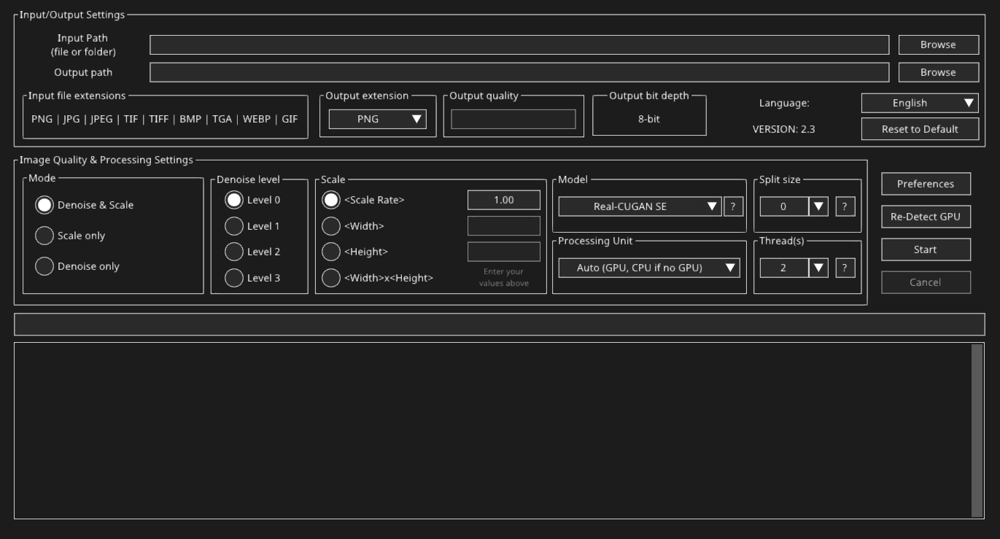
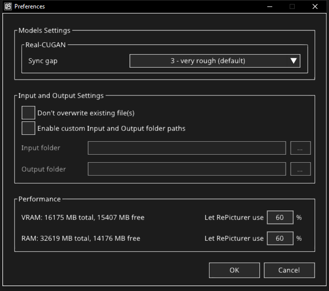
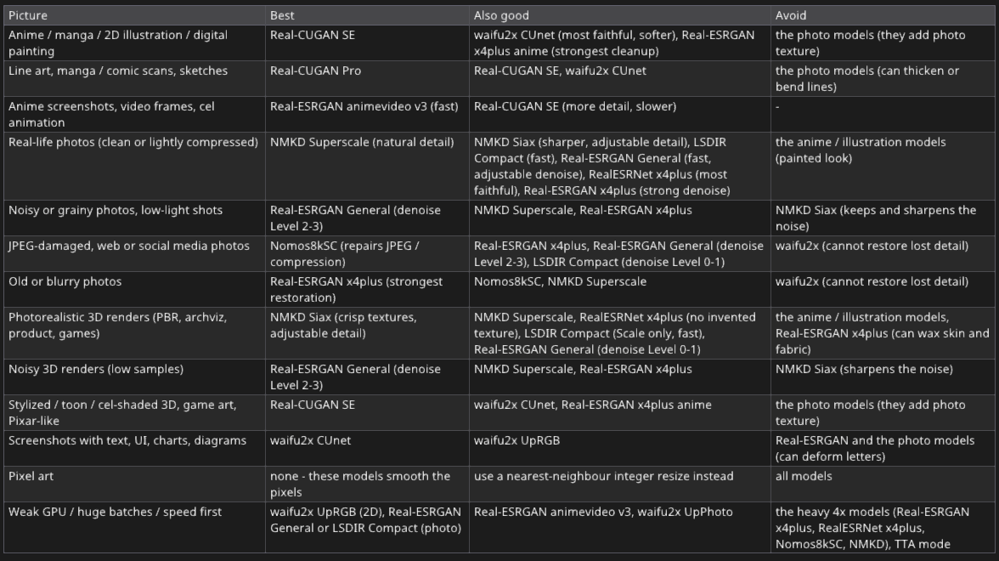

# RePicturer

<p align="center"></p>

**RePicturer** is a free, open-source AI image upscaler and denoiser for **Windows and Linux**. It enlarges pictures (any scale,
or an exact width / height) and removes noise, JPEG artifacts and blur, using 16 AI models for anime and illustrations,
real-life photos and photorealistic 3D renders. It runs on any **Vulkan** GPU (NVIDIA, AMD, Intel) with no CUDA, Python or
installer needed: unzip and run. A CPU fallback is built in.

**Based on:** the GUI is rebuilt from **waifu2x-caffe** (lltcggie), and the converter (`repicturer-cli`) is built on
**waifu2x-ncnn-vulkan**, **realcugan-ncnn-vulkan** (nihui) and **Real-ESRGAN-ncnn-vulkan** (Xintao Wang), all running on Tencent's
**ncnn**. RePicturer is an independent project; it is not affiliated with these projects or the model authors.

## Download

Get `RePicturer-windows.zip` or `RePicturer-linux.zip` from the **[Releases](https://github.com/Valdraath/repicturer/releases)** page, unzip it anywhere and start
`RePicturer.exe` (Windows) or `./RePicturer` (Linux). The release downloads contain the program, the converter and all models.

## Linux: first start

1. **Unpack** the zip (use `unzip`, it keeps the executable permission):

   ```
   unzip RePicturer-linux.zip
   cd RePicturer-linux
   ```

2. **Make the programs executable.** Three files need the `+x` permission: `RePicturer` (the app), `repicturer-cli`
   (the converter it runs) and `install-desktop-entry.sh`. Some archive tools and downloads drop it, so run this once:

   ```
   chmod +x RePicturer repicturer-cli install-desktop-entry.sh
   ```

3. **Start it:**

   ```
   ./RePicturer
   ```

4. **Optional: add it to the application menu** (with its name and icon, no root needed). Run it again if you move the folder:

   ```
   ./install-desktop-entry.sh
   ```

**Requirements:** a 64-bit Linux with glibc 2.27 or newer (Ubuntu 18.04+, Debian 10+, Fedora, Arch, ...), an X11 or
Wayland desktop (Wayland through XWayland), OpenGL 3.0 and a **Vulkan driver**:

| Distribution | Install the Vulkan driver |
|---|---|
| Ubuntu / Debian / Mint | `sudo apt install libvulkan1 mesa-vulkan-drivers` (NVIDIA: the proprietary driver) |
| Fedora | `sudo dnf install vulkan-loader mesa-vulkan-drivers` (NVIDIA: the proprietary driver) |
| Arch / Manjaro | `sudo pacman -S vulkan-icd-loader` plus `vulkan-radeon`, `vulkan-intel` or `nvidia-utils` |

**If something goes wrong:**

* **"Permission denied"** when starting it: step 2 was skipped, run the `chmod` command.
* **Nothing happens on double-click** in the file manager: start it from a terminal with `./RePicturer`, or use the menu
  entry from step 4.
* **Re-Detect GPU finds no GPU:** install or update the Vulkan driver above. Without one, RePicturer still works on the CPU,
  only much slower.

## Support the project

If you like the project, consider supporting me at: **[paypal.me/TheRunningRiot](https://paypal.me/TheRunningRiot)**

## Features

* **16 models, 3 engines:** waifu2x, Real-CUGAN and Real-ESRGAN, plus the community photo models NMKD Siax / Superscale,
  Nomos8kSC and LSDIR Compact. The **?** button explains which model to use for which picture.
* **Any size:** a scale rate, a target width or height, or width x height.
* **Modes:** Denoise & Scale, Scale only and Denoise only, with denoise or detail levels.
* **Formats:** PNG, JPG, TIF, BMP, TGA, WEBP and GIF in; 12 output formats, always written in 8 bit (the AI models work in 8 bit). Animated GIF / WebP stay animated.
* **One image or a whole folder:** sub folders included, with drag & drop and an option not to overwrite existing files.
* **Performance control:** RePicturer uses at most the share of free GPU memory (VRAM) and RAM you allow, and an image that
  runs out of GPU memory is retried automatically with safer settings instead of being saved incomplete.
* **GPU or CPU:** any Vulkan GPU (NVIDIA, AMD, Intel), with the CPU as a fallback.
* **10 languages:** English, Chinese (Traditional / Simplified), Japanese, Korean, Portuguese (Brazil), Russian, Spanish, Ukrainian, Vietnamese.

The converter behind the GUI (`repicturer-cli`, based on waifu2x-ncnn-vulkan) is ncnn rebuilt from source with the waifu2x-caffe features added, so every engine supports:

* any scale ratio, or a target width, height or width x height;
* denoise modes;
* 12 output formats (8 bit);
* folders, recursion and no-overwrite.

```
RePicturer(.exe)              the program (GUI)
repicturer-cli(.exe)          converter used by the GUI (also usable from the command line)
models-*/                     16 models, see below
lang/                         10 languages
fonts/                        Noto Sans fonts for every UI language
crop_size_list.txt            split size presets (same file as waifu2x-caffe)
icon.png, install-desktop-entry.sh   (linux) application menu entry
```

## User interface



The interface is based on the classic **waifu2x-caffe** GUI, so its users feel at home right away: the same layout of
input / output, mode, denoise level, scale and model. It has been rebuilt from scratch with Dear ImGui and refined with a
modern **dark theme**, sharp scalable text in every language, and a window that can be resized and maximized (everything
scales with it). Every option has a hover tip, and the **?** buttons open short guides. Only the options people really use
are kept, so it stays simple.

<p align="center"></p>

**Preferences** holds the few advanced settings: the Real-CUGAN sync gap, not overwriting existing files, optional custom
input / output folders, and how much of the free GPU memory and RAM RePicturer may use.

## What RePicturer adds

Beyond the original waifu2x-caffe GUI, RePicturer brings its own improvements:

* **Performance control:** the share of free VRAM and RAM RePicturer may use is set in Preferences (20-80 %, default 60 %),
  like Photoshop's memory setting. Every GPU memory request is counted against it, a Split size that clearly does not fit is
  lowered before the run, and pictures wait for free RAM instead of overloading the computer.
* **Automatic recovery:** an image that runs out of GPU memory is retried up to 3 times, alone on the GPU with a smaller Split
  size, and the next images keep those safer settings. A broken or half-empty image is never saved; if an image still fails,
  the conversion stops with a clear message.
* **Built-in file explorer:** a dark, fast file browser of its own, in a separate window (address bar, back / forward / up,
  home folders and drives, search as you type, keyboard navigation). It remembers the last folder, only lists the image
  types the program reads, and checks the input and output paths before you start, with a clear warning when a path is wrong.
* **Model guide:** the **?** button next to the model list shows which model is best, also good or to avoid for each kind
  of picture (anime, photos, JPEG-damaged pictures, photorealistic or noisy 3D renders, text, pixel art ...), and explains
  every model.
* **Controls that follow the model:** options a model cannot use are locked with a tooltip that says why. Models with
  always-on cleanup run in Scale only; heavy 4x models lock Thread(s) to 1 so they never run out of GPU memory.
* **Adjustable models:** denoise levels for Real-ESRGAN General and LSDIR Compact, and a **Detail level** (Faithful /
  Balanced / Detailed / Maximum) for NMKD Siax, made by blending each model's official network versions.
* **Any size, really processed:** any scale rate, width, height or width x height, also 1.00x: every mode that scales runs
  the network and then resizes to the exact size. Real-ESRGAN x4plus has its native 2x network (x2plus) for faster 2x.
* **Animated GIF and WebP** stay animated, with frame timing and loop count kept.
* **Safe input:** every field only accepts valid values (scale, size, the quality range of each output format, the memory
  shares), with a warning right away instead of a failed conversion. `setting.ini` is checked and repaired at startup,
  and Reset to Default keeps your language.
* **10 languages** with bundled Noto fonts, every label checked to fit.
* **CPU fallback that works:** the CPU crashes of the ncnn releases are fixed, and Real-ESRGAN gets a CPU path.
* **Portable on Windows and Linux:** unzip and run, no installer, no Python, no CUDA; a Linux menu entry is one script away.

## Models

The **?** button next to the model list in the program explains each model and lists which one to use for which kind of picture.



| Model | Engine | Native scale | Use it for |
|---|---|---|---|
| **Real-CUGAN SE** (default) | Real-CUGAN | 2x 3x 4x | Anime, manga, 2D illustration, stylized 3D: the best overall for 2D |
| Real-CUGAN Pro | Real-CUGAN | 2x 3x | Line art and comics: sharper |
| Real-CUGAN NoSE | Real-CUGAN | 2x | Clean 2D sources, no denoise |
| **NMKD Superscale** | Real-ESRGAN (ESRGAN) | 4x | Photos and photorealistic 3D renders: natural detail, a good first choice |
| NMKD Siax | Real-ESRGAN (ESRGAN) | 4x | Clean photos and renders: crisp textures (keeps noise), with a Detail level |
| Nomos8kSC | Real-ESRGAN (ESRGAN) | 4x | JPEG-damaged, web and social media photos |
| Real-ESRGAN General | Real-ESRGAN | 4x | Photos, noisy renders: fast, with adjustable denoise (Level 0-3) |
| LSDIR Compact | Real-ESRGAN (Compact) | 4x | Clean photos and renders, fast: Scale only keeps the most detail, Level 0-3 add more and more cleanup |
| RealESRNet x4plus | Real-ESRGAN | 4x | Clean photos and renders: faithful, does not invent texture |
| Real-ESRGAN x4plus | Real-ESRGAN | 2x (x2plus) 4x | Photos and realistic 3D: good, but its strong built-in denoise cannot be turned down and can wipe out detail |
| Real-ESRGAN x4plus anime | Real-ESRGAN | 4x | Strong cleanup of 2D art |
| Real-ESRGAN animevideo v3 | Real-ESRGAN | 2x 3x 4x | Anime video frames / screenshots, very fast |
| waifu2x CUnet | waifu2x | 2x | The most faithful to the original 2D art, softer |
| waifu2x UpResNet10 | waifu2x | 2x | Balanced 2D (converted from waifu2x-caffe) |
| waifu2x UpRGB | waifu2x | 2x | The fastest 2D model |
| waifu2x UpPhoto | waifu2x | 2x | Photos: light and fast, for weak GPUs or very large batches |

The outdated waifu2x-caffe vgg_7 models (RGB, Photo, Y, ukbench) are no longer shipped. Newer models beat them in both quality and speed. Any extra `models-*` folder you drop next to the program appears in the list.

**Denoise level by engine:**
* waifu2x: 0-3, each level stronger than the last.
* Real-CUGAN: 0 = conservative, 1-3 = denoise; SE has levels 1-2 at 2x only, Pro has 0 and 3.
* Real-ESRGAN General: 0-3 = denoise strength 25 / 50 / 75 / 100 % (Scale only = 0 %). The folder holds the official realesr-general-x4v3 and realesr-general-wdn-x4v3 networks blended at those strengths.
* LSDIR Compact: Scale only = no cleanup (4xLSDIRCompactN3); Level 0 = JPEG cleanup (C3), Level 1 = 75 % C3 + 25 % R3 (the author's own blend), Level 2 = 50 / 50, Level 3 = blur, noise and JPEG (R3).
* NMKD Siax: the box becomes **Detail level** (Faithful / Balanced / Detailed / Maximum = 40 / 60 / 80 / 100 % Siax, blended with ESRGAN RRDB_PSNR_x4, the soft model it was trained from). It is not a denoise level and works in every mode.
* The other Real-ESRGAN, NMKD and Nomos8kSC models: no levels, because the network removes noise, JPEG artifacts and blur by itself.

**Heavy models:** Real-ESRGAN x4plus, RealESRNet x4plus, Nomos8kSC and NMKD Siax / Superscale are large 4x networks. Thread(s) is locked at 1 for them (greyed out): each GPU converts one image at a time, so they do not run out of video memory.

**Model licenses:** waifu2x and Real-CUGAN are MIT, Real-ESRGAN (x4plus, RealESRNet, General, anime) is BSD-3-Clause, Nomos8kSC and LSDIR Compact are CC-BY-4.0 (by Helaman) and NMKD Siax / Superscale are WTFPL (by Nmkd). The community models were converted from PyTorch to ncnn for this program; see `THIRD_PARTY_LICENSES.md` and the `LICENSE.txt` in their folders.

## Hardware

* **GPU (default):** any Vulkan GPU, with no CUDA needed:
  * NVIDIA GTX 600 series and newer (GTX 1050 … RTX 50)
  * AMD GCN and newer (RX 470/570 … RX 9000)
  * Intel HD 500+, Iris Xe and Arc

  At startup ncnn checks which fp16/int8 features each device supports. The split (tile) size is chosen automatically from free video memory, so 2 GB cards work.
* **CPU:** used **only as a fallback** when no Vulkan GPU exists (or when you select it). All three engines work on any x86-64 Intel or AMD CPU, with SSE2/AVX/AVX2/AVX-512 chosen at runtime. It is 10-100x slower than a GPU.
* **Driver:** if *Re-Detect GPU* finds nothing, update the graphics driver. On Linux, install the Mesa Vulkan drivers (`mesa-vulkan-drivers`) or the NVIDIA driver, plus `libvulkan1`.

## The GUI (everything waifu2x-caffe-gui has, plus ncnn options)

* **Input/output:** one image or one folder (its sub folders too), with drag & drop. **Browse** opens the program's own dark file explorer (it remembers the last folder), **Reset to Default** clears the paths and returns every setting except the language to the first-start state, after a confirmation, and the output name is filled in automatically (`name(RealCUGAN-SE)(noise_scale)(Level0)(x2.00).png`).
* **Formats:** input PNG, JPG, JPEG, TIF, TIFF, BMP, TGA, WEBP and GIF (fixed). Output .png .bmp .jpg .jp2 .sr .tif .hdr .exr .ppm .webp .tga .gif, with quality (webp quality 101 = lossless). The output is always 8 bit, because the AI models work in 8 bit; 16-bit source files are read and converted.
* **Animated GIF / WebP:** every frame is converted with the same model and settings, and the result stays animated, keeping frame timing and loop count. Output .gif or .webp keeps that format, so GIF can become animated WebP and vice versa. Any other output format saves the animation in its source format (GIF -> .gif, WebP -> .webp), with a note in the log. GIF output uses an optimized 256-colour palette per frame with transparency. The progress bar shows the frame being converted.
* **Modes:** Denoise & Scale, Scale only and Denoise only, with denoise levels. Models whose cleanup is built in and cannot be turned off (Real-ESRGAN x4plus / x4plus anime / animevideo v3, RealESRNet, Nomos8kSC, NMKD) only allow **Scale only**, selected automatically; at 1.00x they clean up the image at its original size.
* **Scale:** `<Scale Rate>` (digits, up to 2 decimals), `<Width>`, `<Height>` (whole numbers) or `<Width>x<Height>` (e.g. 1920x1080). Each box only accepts its own format; anything else is blocked with a warning.
* **Processing:** Split size (0 = auto) and Thread(s) (1-32, replaces caffe's batch size), each with a hover tip and a **?** guide.
* **GPU memory limit** (Preferences): RePicturer uses at most a share of the GPU memory that is free when a conversion starts
  (20-80 %, default 60 %). An image that runs out of GPU memory is retried up to 3 times with 1 thread and a smaller Split size instead of
  being saved incomplete; if it still fails, the conversion stops.
* **RAM limit** (Preferences): the pictures in progress use at most a share of the RAM that is free when a conversion starts
  (20-80 %, default 60 %); when it is reached the next pictures wait.
* **Processing Unit:** Auto / each GPU / CPU (the GPU runs on Vulkan, the CPU works without it) and a **Re-Detect GPU** button.
* **Preferences:** no overwrite and custom input and output folders (off by default: the main window's paths are used). Models Settings: the Real-CUGAN sync gap. Performance: the GPU memory and RAM limits.
* **Other:** 10 UI languages (English, Chinese Traditional / Simplified, Japanese, Korean, Portuguese (Brazil), Russian, Spanish, Ukrainian, Vietnamese), progress bar, time left, log, and `setting.ini` next to the program.
* **Window:** resizable and maximizable. The content scales up with the window (fonts, boxes, buttons) up to a 1360 px wide column, centred horizontally and pinned to the top. The log grows up to twice its height when there is room. The original size is the minimum.
* **Pass report:** the log shows which networks really ran for every image, e.g. `noise2_scale2.0x_model (x2) -> scale2.0x_model (x2) -> resize 800x600 to 2560x1920`. This shows that Denoise & Scale really did both.
* **Command line:** the window takes no command-line options. For scripts and batch work, run the converter
  `repicturer-cli` in a terminal (Command Prompt, PowerShell or a Linux shell); `repicturer-cli -h` lists its options.

## How any scale works

1. The factor is worked out from the rate, the target width, the target height, or for width x height the larger of the two.
2. The first pass applies the chosen denoise level. Further native passes (x2 / x3 / x4, picked by the smallest scale that reaches the target) run until the size is at least the target.
3. The result is resampled to the exact size with a high-quality cubic filter. Width x height is stretched to exactly W x H, as in waifu2x-caffe.

## Converter command line

```
repicturer-cli -i in -o out [-m model-folder] [-n level] [-s rate | -W width | -H height] [-M noise|scale|noise_scale]
                    [-f format] [-q quality] [-t tile] [-g gpu(s)] [-j l:p:s] [-c syncgap]
                    [--vram-percent 20-80] [--ram-percent 20-80]
                    [-l png:jpg] [-r] [-k] [-L list.txt] [--list-gpu] [--progress] [-v]
```

The engine follows the model folder (`models-cunet`, `models-realcugan-se`, `models-realesrgan-x4plus`, …). Upstream waifu2x-ncnn-vulkan options keep working.

## Fixes compared with the official ncnn releases

* **CPU mode crashed in waifu2x-ncnn-vulkan 20250915.** It called `set_vulkan_device(NULL)` and lacked the Gemm layer that CPU deconvolution needs. Both are fixed, and the program falls back to the CPU when no GPU is found.
* **Real-ESRGAN gets a CPU path,** which the official realesrgan-ncnn-vulkan never had.
* **Robustness:** model loading errors are reported, destructors are null-safe, and the pixel order is the same on every OS.
* **MinGW builds** use `-Wa,-muse-unaligned-vector-move`, which prevents AVX/AVX-512 crashes on CPUs such as the i7-11800H and Ryzen 7000.
* **Incomplete images:** the ncnn engines skipped tiles when GPU memory ran out and still saved the image, so parts of it
  were empty. RePicturer detects every failed GPU memory request and retries the image instead.
* **Real-CUGAN on the CPU** crashed for pictures with transparency that need more than one tile; fixed.

## Building

The sources of every dependency are in `third_party/`: ncnn + glslang, zlib-ng, libwebp, OpenJPEG, Dear ImGui, GLFW, stb and the X11 headers.

Requirements: CMake 3.16+, Ninja (or make) and a C++17 compiler: MinGW-w64 GCC on Windows (for example w64devkit),
GCC or Clang on Linux. No Vulkan SDK, X11 or OpenGL development packages are needed.

**Windows** (MinGW-w64):

```
cmake -S . -B build -G Ninja -DCMAKE_BUILD_TYPE=Release -DCMAKE_C_COMPILER=gcc -DCMAKE_CXX_COMPILER=g++
cmake --build build --target repicturer-cli repicturer
```

**Linux:**

```
cmake -S . -B build -G Ninja -DCMAKE_BUILD_TYPE=Release -DCMAKE_EXE_LINKER_FLAGS="-static-libgcc -static-libstdc++"
cmake --build build --target repicturer-cli repicturer
```

**Linux, cross-compiled with Zig** (from Windows, macOS or Linux; set `ZIG` to the zig executable, targets glibc 2.27):

```
cmake -S . -B build-linux -G Ninja -DCMAKE_BUILD_TYPE=Release -DCMAKE_TOOLCHAIN_FILE=cmake/zig-linux.cmake
cmake --build build-linux --target repicturer-cli repicturer
```

The programs are written to `build/bin`. To run them, put `resources/lang`, `resources/fonts`, `resources/crop_size_list.txt` and
the `models-*` folders next to them. The model files are not stored in the repository (about 400 MB): take the `models-*`
folders from a release download (see `resources/models/README.md`).

## Credits / licenses

Every bundled model and library allows free use, sharing and changes, also commercially. Their license texts ship in the `licenses/` folder.

* **waifu2x:** nagadomi, MIT
* **waifu2x-caffe:** lltcggie, MIT
* **waifu2x-ncnn-vulkan:** nihui, MIT
* **Real-CUGAN:** Bilibili AI Lab, MIT; ncnn port by nihui, MIT
* **Real-ESRGAN models** (x4plus, x2plus, x4plus anime, animevideo v3, RealESRNet, General): Xintao Wang / Tencent ARC, BSD-3; Real-ESRGAN-ncnn-vulkan engine code, MIT
* **NMKD Siax / Superscale:** Nmkd, WTFPL (fine-tuned from ESRGAN by Xintao Wang, Apache-2.0)
* **Nomos8kSC, LSDIR Compact:** Helaman (Philip Hofmann), CC-BY-4.0 (converted to ncnn; LSDIR Compact levels 1-2 are weight blends)
* **ESRGAN** (RRDB_PSNR_x4, used for the NMKD Siax detail levels): Xintao Wang, Apache-2.0
* **Libraries:** ncnn (Tencent, BSD-3), glslang, libwebp (BSD-3), OpenJPEG (BSD-2), zlib-ng (zlib), Dear ImGui (MIT), GLFW (zlib), stb (MIT / public domain), Noto Sans fonts (SIL OFL 1.1), Roboto (Apache-2.0)
* **Languages:** the translations start from the waifu2x-caffe language files (MIT) and were completed for RePicturer; Ukrainian translation by Dymkom

See `THIRD_PARTY_LICENSES.md`.
